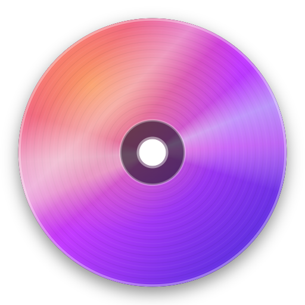
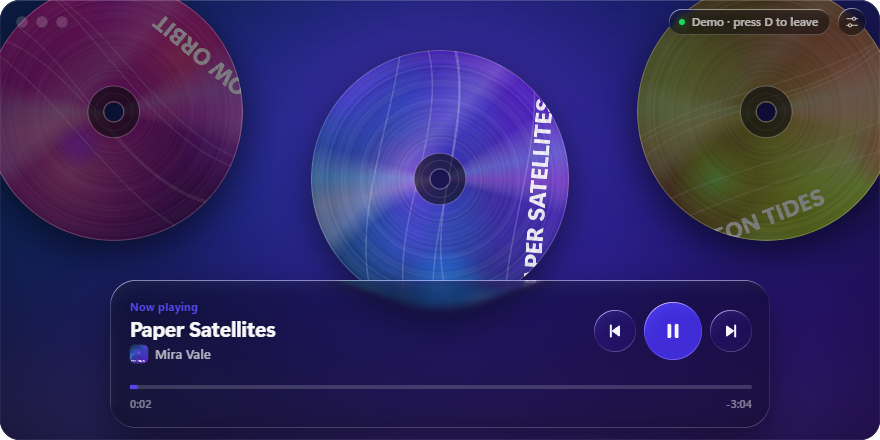
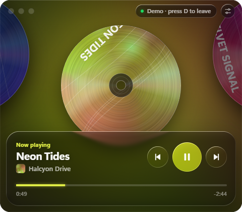

<p align="center">
  
</p>

<h1 align="center">Rimshot</h1>

<p align="center">
  A dark, liquid-glass mini player for Windows that rolls your music on CDs around the rim of a giant wheel.
</p>

<p align="center">
  
</p>

Every track is a CD on the rim of a huge wheel, and you only ever see the bottom of it. When you skip, the current disc rolls off to the right and up along the rim, and the next one rolls in from the left. The glass panel bends the discs as they pass underneath it, and the colours follow the album art.

Rimshot reads Windows' own media controls (the same source as the volume flyout). That means:

- **Works with the Spotify desktop app, including free accounts.** No login, API key or Premium needed.
- **Works with other players too:** browsers (YouTube, SoundCloud), Apple Music, and anything else that shows up in the Windows media flyout. When several are playing, Spotify wins.

<p align="center">
  
</p>

## Install

1. Download **`Rimshot-Setup-x.y.z.exe`** from the [latest release](https://github.com/JesseVerboven/rimshot/releases/latest).
2. Run it and follow the steps. It installs for your user only and doesn't need admin rights.
3. Start **Rimshot** from the Start menu or the desktop shortcut, then play something in Spotify.

> **"Windows protected your PC"?** The installer isn't code-signed yet, so SmartScreen warns about it. Click **More info → Run anyway**. You can also build the installer yourself from source (see below).

Requires Windows 10 (version 1809 or later) or Windows 11.

## Controls

| Action | How |
| --- | --- |
| Play / pause | Play button, click the centre disc, or `Space` |
| Next / previous | Buttons, `←` / `→`, or click the disc on the left / right |
| Spin the wheel | Drag sideways and flick. Momentum decides how many tracks to skip (up to 3) |
| Seek | Click or drag the progress bar. Hover shows the time. `←` / `→` while it's focused moves 5 s |
| Settings | Sliders button, top right |
| Window size | Settings → Compact (480×420), Wide (880×440) or Full screen |
| Full screen | `F11` or Settings. `Esc` leaves. The title bar and cursor fade out when the mouse rests |
| Keep on top | Settings or the green dot. Stays above other windows, including other always-on-top ones |
| Spin discs / Ambient glow | Settings toggles |
| Demo mode | `D` (generated covers, no player needed) |

- Only the playing disc spins. It spins up when it rolls in and winds down when you pause.
- Previous works like Spotify: past 3 seconds it restarts the song. Dragging the wheel back always goes to the previous disc.
- Settings and the window position are saved in `%APPDATA%\Rimshot\settings.json`.

## Run from source

You need [Node.js](https://nodejs.org) 20 or newer and Windows.

```bash
git clone https://github.com/JesseVerboven/rimshot.git
cd rimshot
npm install
npm start
```

## Build the installer

```bash
npm run dist
```

This creates `dist/Rimshot-Setup-<version>.exe` (an NSIS installer) and `dist/win-unpacked/Rimshot.exe` (the app without an installer, handy for testing). The version comes from `package.json`.

To redraw the app icon (`build/icon.ico` and `build/icon.png`) after changing `build/make-icon.js`:

```bash
npm run icon
```

## How it works

| File | What it does |
| --- | --- |
| `main.js` | The Electron window: size modes, full screen, keep-on-top, settings, taskbar identity. It also starts the media bridge. |
| `native/media-bridge.ps1` | A long-running PowerShell process that talks to Windows' `GlobalSystemMediaTransportControlsSessionManager`. It streams the current track, position and album art as JSON lines, and takes play/pause/skip/seek commands on stdin. |
| `src/app.js` | The wheel: timeline of discs, the spring-driven roll, drag-and-flick gestures, progress and scrubbing, the settings menu. |
| `src/discs.js` | Draws the CDs on a canvas. The print rotates with the disc, while the iridescent sheen and highlight stay fixed to the light. |
| `src/spring.js` | Apple-style springs (damping + response), momentum projection and rubber-banding, following *Designing Fluid Interfaces* (WWDC 2018). |
| `src/glass.js` | The liquid glass: a WebGL shader that refracts, blurs and tints the live CD canvas under every glass surface, every frame. |
| `src/sources.js` | Playback sources: Windows media controls and the demo. |

Windows doesn't expose the upcoming queue, so Rimshot can't know the next cover in advance. When you skip, a blank disc rolls in right away and the art fades onto it once the player reports the new track.

## Credits

- The glass refraction model is adapted from [liquid-glass-js](https://github.com/dashersw/liquid-glass-js) by Armagan Amcalar (MIT). See [THIRD_PARTY_NOTICES.md](THIRD_PARTY_NOTICES.md).
- Motion follows Apple's *Designing Fluid Interfaces* principles, via [emilkowalski/skills](https://github.com/emilkowalski/skills).

Rimshot is not affiliated with or endorsed by Spotify.

## License

[MIT](LICENSE) © 2026 Jesse Verboven
